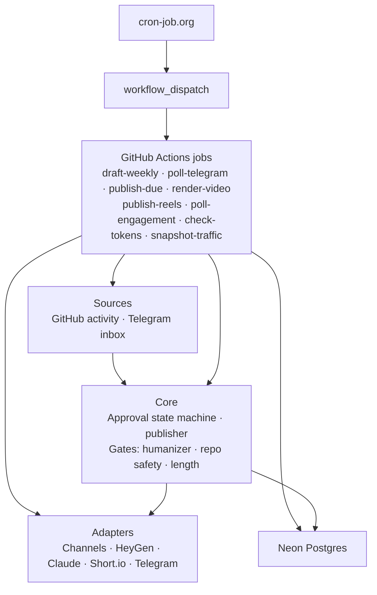
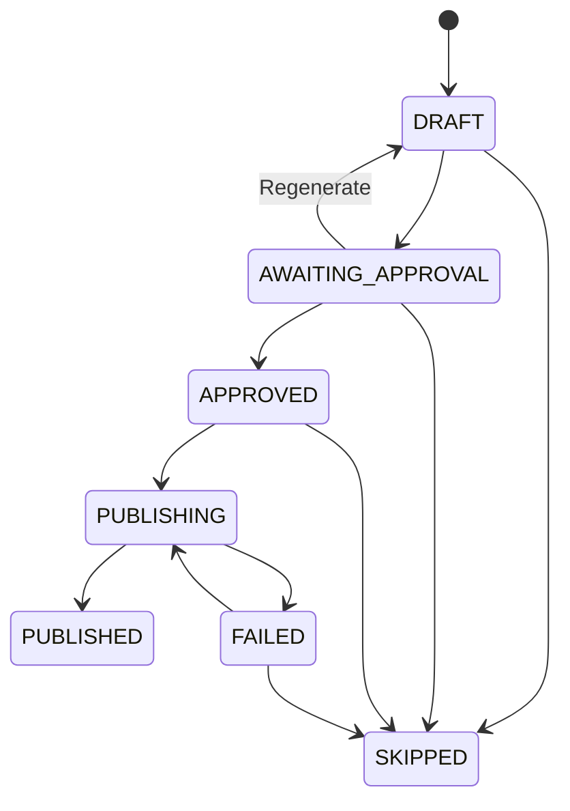

# Postpilot

Postpilot turns Volodymyr Shemchuk's GitHub activity and Ukrainian Telegram drafts into social posts and avatar videos. It runs his publishing workflow in production and serves as a portfolio project for automation engineering roles. Every post requires explicit approval in Telegram, and each video has a separate approval before it goes out.

## What it does

| Source | Workflow |
| --- | --- |
| **S1 · Weekly GitHub activity** | Drafts German and Ukrainian posts on Wednesday for Friday publication after approval. A series can cover the same project over several weeks. |
| **S2 · Ukrainian text in Telegram** | Keeps the Ukrainian original and translates it into German for review. Approved text publishes on demand. |

LinkedIn gets separate German and Ukrainian posts. Threads gets shortened German text. HeyGen renders a German avatar video from the approved LinkedIn German variant. Instagram Reels and Facebook Reels publish the approved video with separate credentials and an AI-generated label.

The bot drafts replies to LinkedIn comments from Gmail notifications for manual posting, and drafts Threads replies with a one-click **Send** button. It also reports new GitHub stars and forks, shows engagement and traffic with `/stats`, and offers LinkedIn profile advice with `/advise`.

## Architecture





- **Ports and adapters.** The core defines publishing rules and uses channel interfaces for network-specific behavior. [ADR 002](docs/decisions/002-ports-and-adapters.md)
- **Idempotent publishing.** The publisher claims each item and channel before calling the network. LinkedIn recovery looks for the post marker. Threads stores the container ID before publishing and checks its status on recovery. [ADR 009](docs/decisions/009-linkedin-channel.md), [ADR 013](docs/decisions/013-threads-hidden-idempotency.md)
- **Token lifecycle.** Postgres stores tokens encrypted. A daily job tries silent refresh where supported and prompts for assisted renewal in Telegram when needed. [ADR 005](docs/decisions/005-token-lifecycle.md)
- **Serverless jobs.** Short GitHub Actions runs execute the pipeline. cron-job.org dispatches them, with GitHub schedules as fallback. [ADR 001](docs/decisions/001-hosting-github-actions.md), [ADR 017](docs/decisions/017-external-trigger-and-one-click-replies.md)
- **Neon compute budget.** The Telegram poll skips Postgres when there are no updates, except in the first five minutes of each UTC hour. This limits idle wakeups on the free tier. [ADR 003](docs/decisions/003-state-store-postgres.md), [ADR 017](docs/decisions/017-external-trigger-and-one-click-replies.md)
- **AI disclosure.** Each Reel carries a burned-in AI-generated label and a caption disclosure. [ADR 006](docs/decisions/006-ai-label.md), [ADR 014](docs/decisions/014-reels-publishing.md)

## Scheduled jobs

| Job | cron-job.org trigger | What it does |
| --- | --- | --- |
| `draft-weekly` | Wednesday 18:00 Europe/Berlin. **Paused until 2026-12-16** under the [ADR 018 amendment](docs/decisions/018-weekly-github-draft.md#amendment-2026-11-20-volodymyr-rollout-order). | Collect public GitHub activity, run the draft gates, and send a Telegram preview. |
| `poll-telegram` | Every five minutes | Handle drafts, approvals, commands, and renewals. Publish approved on-demand text. |
| `publish-due` | Friday 09:00 UTC | Publish approved weekly text and resume unfinished publications. |
| `render-video` | Friday 10:00 UTC | Check the render budget and send an eligible HeyGen video for approval. |
| `publish-reels` | Hourly at :00 UTC | Publish approved videos to Instagram and Facebook and report each result. |
| `poll-engagement` | Every 30 minutes | Check LinkedIn notifications, Threads replies, and GitHub stars and forks. |
| `check-tokens` | Daily 07:00 UTC | Check expiry, attempt refresh, and prompt for renewal when needed. |
| `snapshot-traffic` | Daily 07:30 UTC | Store GitHub traffic and Short.io click counts. |

The GitHub fallback runs `draft-weekly` at Wednesday 17:00 UTC, `poll-engagement` every 10 minutes, and `publish-reels` every 15 minutes. See the [runbook](docs/runbook.md) for dispatch and operations.

## Demo

1. Volodymyr sees the German and Ukrainian weekly drafts in Telegram. The source block shows the repository, series part when applicable, commit count, and whether the repository link passed the safety gate.
2. He taps **Approve** to queue Friday publication, **Regenerate** to get a new preview from the saved GitHub facts, or **Skip** to discard the draft. For an on-demand Ukrainian draft, he reviews the German translation and can edit it before approving.
3. The render job takes an eligible approved German LinkedIn variant and sends a HeyGen video with subtitles and an AI-generated label.
4. Volodymyr watches the video preview in Telegram and taps **Approve** to release it to the Reels job, or **Reject** to discard it. Telegram reports the published link or failure for each Reels channel.

**Published by postpilot**

- [LinkedIn post](https://www.linkedin.com/feed/update/urn:li:share:7529221426441293825/)
- [Facebook Reel](https://www.facebook.com/reel/29464402036524870)
- [Instagram Reel](https://www.instagram.com/reel/Df9GFbUknyT/) and [second Instagram Reel](https://www.instagram.com/reel/Df9GPvuD14b/)

## Engineering practice

Work proceeds through the [interview](docs/00-interview.md), [spec](docs/01-spec.md), [architecture](docs/02-architecture.md) and ADRs, then the [task plan](docs/03-tasks.md). Claude Code owns the spec and ADRs and reviews and merges task PRs. Codex implements tasks. Volodymyr approves project gates and publications, manages secrets, and can veto merges. [STATUS.md](docs/STATUS.md) records the handoff.

Each task gets one PR and uses Conventional Commits. [CI](.github/workflows/ci.yml) runs Ruff lint and format checks, mypy, pytest, and a secret scan. Tests replace external service calls with fakes, exercise each channel through contract tests, and run storage integration tests against a throwaway Postgres schema. The latest recorded run had 819 passing tests, including integration tests, at the time of writing. [Verification record](docs/STATUS.md)

## Decision records

See the [ADR index](docs/decisions/README.md) for the decisions behind hosting, publication recovery, token storage, and rollout.

## Reused LinkedIn app

Postpilot reuses the previous production agent's LinkedIn developer app credentials (Client ID and Secret). Postpilot ran a fresh OAuth authorization and holds its own access token. The old access token was never copied. The app's redirect allowlist includes the [GitHub Pages callback](site/callback/).

The app already has the LinkedIn products the posting flow needs. Reuse avoids managing a second set of app credentials, and this portfolio documents the shared dependency. The agents share the app's rate limits during the side-by-side T18 cutover. [Spec §7](docs/01-spec.md#7-decisions-and-open-questions), [ADR 005](docs/decisions/005-token-lifecycle.md), [ADR 009](docs/decisions/009-linkedin-channel.md)

## Repository layout

```text
src/postpilot/
├── ai/           Claude client, prompts, humanizer, and profile advice
├── channels/     LinkedIn, Threads, and Reels publishing adapters
├── core/         Item states, gates, limits, and text publisher
├── engagement/   Comment monitoring, reply drafts, and engagement log
├── jobs/         Workflow job entry points and failure alerts
├── links/        Short.io links and traffic snapshots
├── notify/       Telegram client, approval handling, and renewal prompts
├── sources/      GitHub activity, series, and Telegram text intake
├── store/        Postgres access and SQL migrations
├── tokens/       Encrypted token storage and provider renewal
└── video/        HeyGen rendering, labelling, and Reels publishing
docs/             Spec, architecture, ADRs, task plan, and runbook
site/             GitHub Pages OAuth callback
scripts/          Repository tooling, including the secret scanner
.github/workflows/ CI, scheduled jobs, and callback deployment
```

## Local development

With Python 3.12 or later, create and activate a virtual environment, then run:

```sh
python -m pip install -e '.[dev]'
pre-commit install
ruff check .
ruff format --check .
mypy src
pytest
python scripts/scan_secrets.py
```

Run `postpilot` to see the version and available commands.

For integration tests, set `TEST_DATABASE_URL` to a test Postgres connection URL with a direct host. Use the Neon direct endpoint instead of the `-pooler` endpoint so the fixture can set the schema search path. Run `pytest -m integration`. [Verification record](docs/STATUS.md)

## Status and roadmap

Postpilot has been in production since November 2026. The remaining task is [T18 cutover](docs/03-tasks.md), which starts no earlier than 2026-12-11. The two agents will run side by side for two weeks before the previous agent is disabled and removed with Volodymyr's confirmation.

## License

[MIT](LICENSE)
