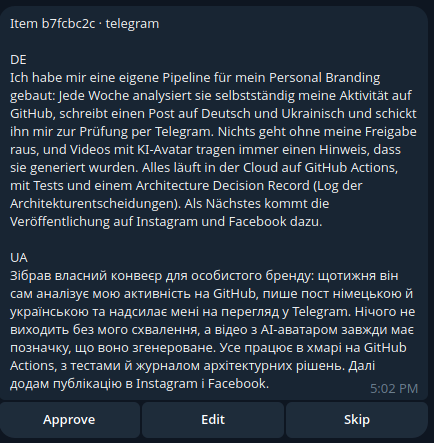
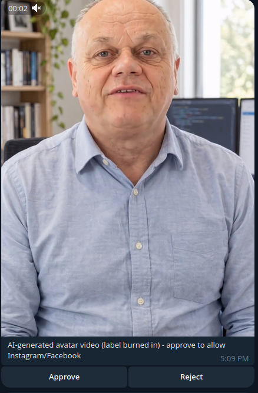
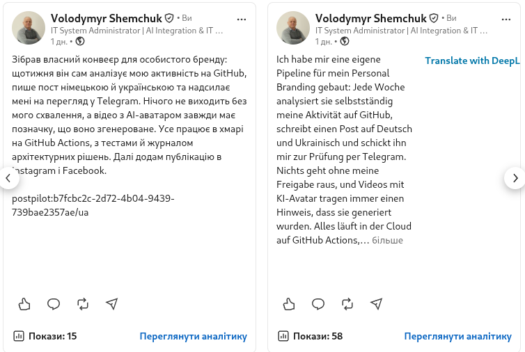
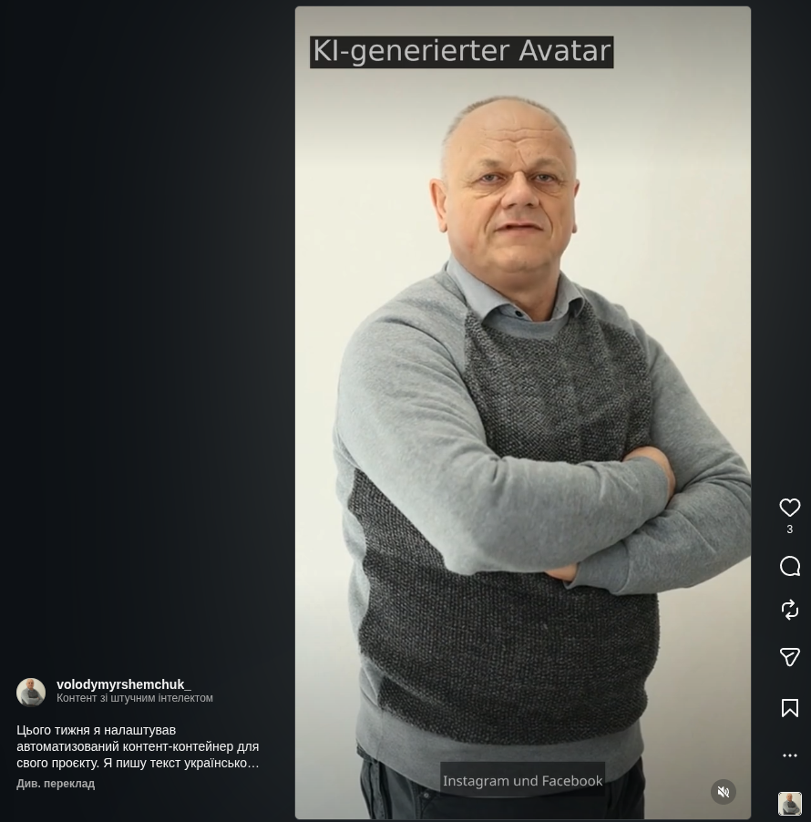
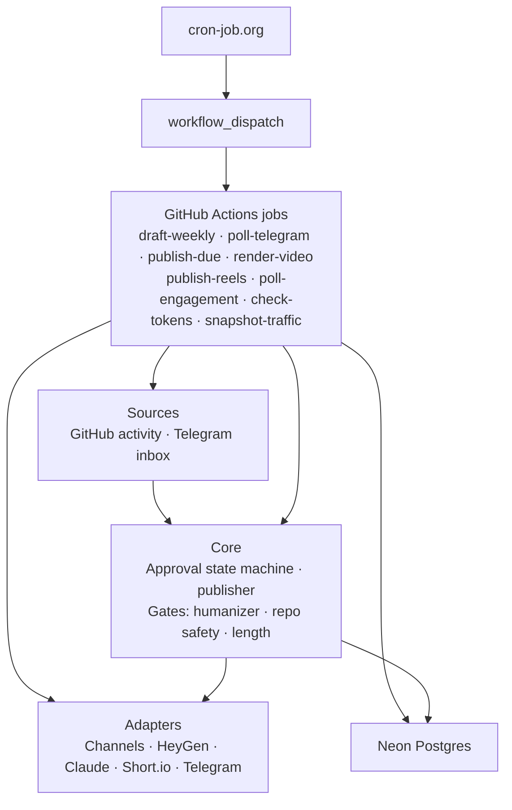
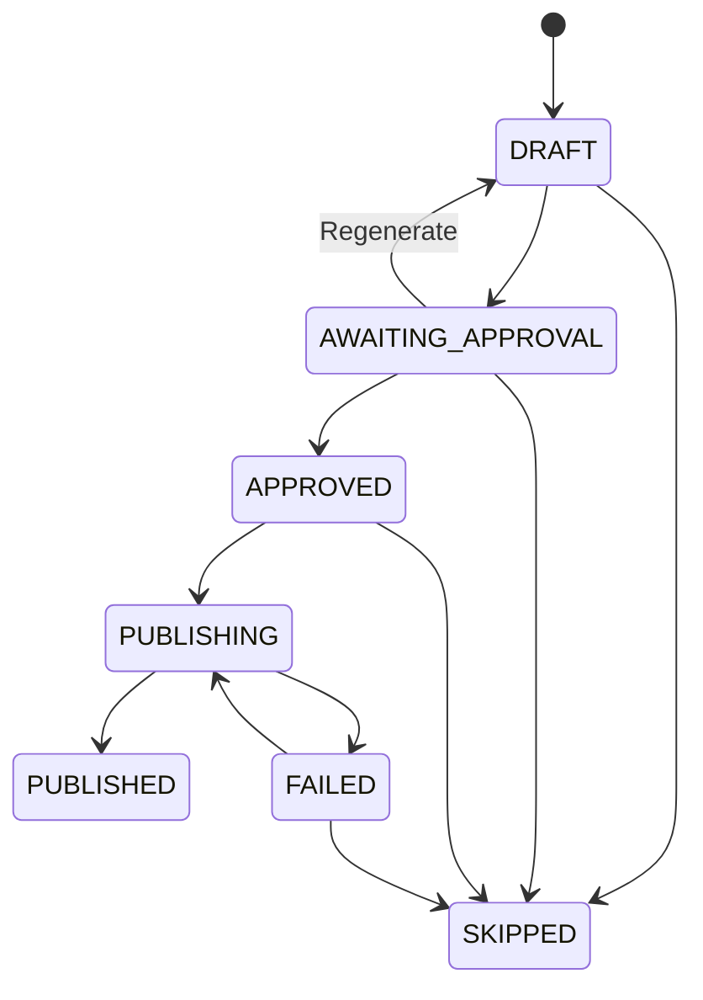

# Postpilot

[](https://github.com/schemchuk/postpilot/actions/workflows/ci.yml)

[](LICENSE)

I built Postpilot to run my own publishing. Every week it reads my GitHub activity and drafts posts in German and Ukrainian. It also takes rough Ukrainian notes I send to a Telegram bot and turns them into German posts. Approved posts go to LinkedIn and Threads, and an avatar video of me goes to Instagram and Facebook Reels. Nothing is published until I tap **Approve** in Telegram, and every video needs its own second approval.

It has been in production since November 2026. Eight scheduled jobs on GitHub Actions do the work. State lives in Neon Postgres, the jobs are triggered by cron-job.org, and the test suite has 819 tests. The infrastructure runs on free tiers. What I pay for is the Claude API and HeyGen, about $1 per rendered video.

## What it does

| Source | Workflow |
| --- | --- |
| **S1 · Weekly GitHub activity** | On Wednesday it drafts German and Ukrainian posts. After I approve them, they go out on Friday. A series can follow one project over several weeks. |
| **S2 · Ukrainian text in Telegram** | It keeps my Ukrainian original and translates it into German for review. Approved text is published right away. |

LinkedIn gets separate German and Ukrainian posts. Threads gets a shorter German version. HeyGen renders a German avatar video from the approved LinkedIn German text. Instagram and Facebook Reels publish the approved video under separate credentials, with an AI-generated label.

The bot also drafts replies to LinkedIn comments from Gmail notifications (I post those by hand). For Threads replies it adds a one-click **Send** button. It tells me about new GitHub stars and forks, shows engagement and traffic with `/stats`, and gives LinkedIn profile advice with `/advise`.

## Demo

1. I get the German and Ukrainian weekly drafts in Telegram. Under the text, a source block shows the repository, the series part if there is one, the commit count, and whether the repository link passed the safety gate.
2. **Approve** queues the posts for Friday. **Regenerate** builds a new draft from the saved GitHub facts. **Skip** discards it. For a Ukrainian note I sent myself, I review the German translation and can edit it before approving.
3. The render job takes an approved German LinkedIn text and sends me a HeyGen video with subtitles and an AI-generated label.
4. I watch the preview in Telegram and tap **Approve** to release it to the Reels job, or **Reject**. Telegram then reports the published link, or the error, for each channel.

| Text approval in Telegram | Video approval in Telegram |
| :---: | :---: |
|  |  |
| **The same item on LinkedIn, in Ukrainian and German** | **Published as an Instagram Reel** |
|  |  |

**Published by Postpilot**

- [LinkedIn post](https://www.linkedin.com/feed/update/urn:li:share:7529221426441293825/)
- [Facebook Reel](https://www.facebook.com/reel/29464402036524870)
- [Instagram Reel](https://www.instagram.com/reel/Df9GFbUknyT/) and [a second one](https://www.instagram.com/reel/Df9GPvuD14b/)

## Architecture





- **Ports and adapters.** The core holds the publishing rules and talks to each network through a channel interface. [ADR 002](docs/decisions/002-ports-and-adapters.md)
- **Idempotent publishing.** The publisher claims each item and channel before it calls the network. On LinkedIn, recovery looks for the post marker. On Threads, the container ID is stored before publishing and recovery checks its status. [ADR 009](docs/decisions/009-linkedin-channel.md), [ADR 013](docs/decisions/013-threads-hidden-idempotency.md)
- **Token lifecycle.** Tokens are stored encrypted in Postgres. A daily job refreshes them silently where the provider allows it, and otherwise asks me in Telegram to renew. [ADR 005](docs/decisions/005-token-lifecycle.md)
- **Serverless jobs.** The pipeline runs as short GitHub Actions jobs. cron-job.org dispatches them, and GitHub schedules stay as a fallback. [ADR 001](docs/decisions/001-hosting-github-actions.md), [ADR 017](docs/decisions/017-external-trigger-and-one-click-replies.md)
- **Neon compute budget.** When Telegram has no updates, the poll skips Postgres (except during the first five minutes of each UTC hour), so the free tier is not spent on idle wakeups. [ADR 003](docs/decisions/003-state-store-postgres.md), [ADR 017](docs/decisions/017-external-trigger-and-one-click-replies.md)
- **AI disclosure.** Every Reel has a burned-in AI-generated label and a disclosure in the caption. [ADR 006](docs/decisions/006-ai-label.md), [ADR 014](docs/decisions/014-reels-publishing.md)

## What broke in production, and what I changed

**A test fixture changed production's search path.** Integration tests ran in a throwaway schema and set `search_path` at session level. The production URL pointed to Neon's PgBouncer pooler in transaction mode, so that setting leaked into a shared server backend. New connections then pointed at a schema that no longer existed. I reset the backend by hand before any job ran. In code, schema-scoped connections now refuse `-pooler` hosts and pass the search path as a libpq startup option instead of a session `SET`. [STATUS incident note](docs/STATUS.md), PR #23

**The idempotency marker was public.** To recover from an uncertain publish, every post ended with `postpilot:<uuid>/<lang>`. On Threads, everyone could see it. Threads has no idempotency key and no private metadata, but publishing takes two calls. So now the container ID is stored before the second call, and recovery reads the container status (`FINISHED` means publish again, `PUBLISHED` means find the post, `ERROR` means start over). [ADR 013](docs/decisions/013-threads-hidden-idempotency.md)

**GitHub's scheduler did not fire.** `poll-engagement` never ran on its `schedule` after the merge, and other workflows started hours late. A reply someone left on Threads waited until I dispatched the job by hand. Now cron-job.org calls `workflow_dispatch` for every workflow with a PAT scoped to this repository, and the GitHub schedule stays as a fallback. Polling every five minutes would have used up Neon's free compute, so the Telegram poll opens the database only when there is work. [ADR 017](docs/decisions/017-external-trigger-and-one-click-replies.md)

**The first live weekly draft failed its own quality gate.** The project picker capped commits at 20, so two repositories tied and the wrong one won. Then the humanizer rejected the German and Ukrainian text three rounds in a row, because the model wrote bullet lists. Nothing was published, which is the point of the gate. I raised the count to 100 commits, changed the prompts to ask for plain paragraphs, and made the failure alert name the step and language. [ADR 018](docs/decisions/018-weekly-github-draft.md)

**A late Telegram button press crashed the job after the change was saved.** When a callback was stale, answering it raised an error after the database commit, and `poll-telegram` exited with an error even though the work was done. Telegram replies after the commit are now non-fatal. PR #21

## Scheduled jobs

| Job | cron-job.org trigger | What it does |
| --- | --- | --- |
| `draft-weekly` | Wednesday 18:00 Europe/Berlin. **Paused until 2026-12-16** under the [ADR 018 amendment](docs/decisions/018-weekly-github-draft.md#amendment-2026-11-20-volodymyr-rollout-order). | Collects public GitHub activity, runs the draft gates and sends a Telegram preview. |
| `poll-telegram` | Every five minutes | Handles drafts, approvals, commands and renewals. Publishes approved on-demand text. |
| `publish-due` | Friday 09:00 UTC | Publishes approved weekly text and resumes unfinished publications. |
| `render-video` | Friday 10:00 UTC | Checks the render budget and sends an eligible HeyGen video for approval. |
| `publish-reels` | Hourly at :00 UTC | Publishes approved videos to Instagram and Facebook and reports each result. |
| `poll-engagement` | Every 30 minutes | Checks LinkedIn notifications, Threads replies and GitHub stars and forks. |
| `check-tokens` | Daily 07:00 UTC | Checks expiry, tries to refresh and asks for renewal when needed. |
| `snapshot-traffic` | Daily 07:30 UTC | Stores GitHub traffic and Short.io click counts. |

The GitHub fallback runs `draft-weekly` on Wednesday at 17:00 UTC, `poll-engagement` every 10 minutes and `publish-reels` every 15 minutes. The [runbook](docs/runbook.md) covers dispatch and operations.

## How I work on it

Every task goes through an [interview](docs/00-interview.md), a [spec](docs/01-spec.md), the [architecture](docs/02-architecture.md) and ADRs, and then the [task plan](docs/03-tasks.md). I use two coding agents. Claude Code writes the spec and ADRs and reviews and merges task PRs, and Codex implements the tasks. I approve the project gates and every publication, manage the secrets, and can veto any merge. [STATUS.md](docs/STATUS.md) is the handoff log between sessions.

Each task is one PR with Conventional Commits. [CI](.github/workflows/ci.yml) runs Ruff lint and format checks, mypy, pytest and a secret scan. External services are replaced with fakes in tests, every channel goes through contract tests, and storage integration tests run against a throwaway Postgres schema. At the time of writing the last recorded run had 819 passing tests, integration tests included. [Verification record](docs/STATUS.md)

## Decision records

The [ADR index](docs/decisions/README.md) lists the decisions behind hosting, publication recovery, token storage and rollout.

## Reused LinkedIn app

Postpilot reuses the LinkedIn developer app (Client ID and Secret) of the agent that ran my publishing before it. It went through its own OAuth authorization and holds its own access token. I never copied the old token. The app's redirect allowlist includes the [GitHub Pages callback](site/callback/).

The app already has the LinkedIn products the posting flow needs, so reusing it means one less set of credentials to manage. The cost is a shared dependency, which is why I document it here. While both agents run side by side during the T18 cutover, they share the app's rate limits. [Spec §7](docs/01-spec.md#7-decisions-and-open-questions), [ADR 005](docs/decisions/005-token-lifecycle.md), [ADR 009](docs/decisions/009-linkedin-channel.md)

## Repository layout

```text
src/postpilot/
├── ai/           Claude client, prompts, humanizer, and profile advice
├── channels/     LinkedIn, Threads, and Reels publishing adapters
├── core/         Item states, gates, limits, and text publisher
├── engagement/   Comment monitoring, reply drafts, and engagement log
├── jobs/         Workflow job entry points and failure alerts
├── links/        Short.io links and traffic snapshots
├── notify/       Telegram client, approval handling, and renewal prompts
├── sources/      GitHub activity, series, and Telegram text intake
├── store/        Postgres access and SQL migrations
├── tokens/       Encrypted token storage and provider renewal
└── video/        HeyGen rendering, labelling, and Reels publishing
docs/             Spec, architecture, ADRs, task plan, and runbook
site/             GitHub Pages OAuth callback
scripts/          Repository tooling, including the secret scanner
.github/workflows/ CI, scheduled jobs, and callback deployment
```

## Local development

With Python 3.12 or later, create and activate a virtual environment, then run:

```sh
python -m pip install -e '.[dev]'
pre-commit install
ruff check .
ruff format --check .
mypy src
pytest
python scripts/scan_secrets.py
```

Run `postpilot` to see the version and the available commands.

For integration tests, set `TEST_DATABASE_URL` to a test Postgres URL with a direct host. On Neon, use the direct endpoint, not the `-pooler` one, so the fixture can set the schema search path. Then run `pytest -m integration`. [Verification record](docs/STATUS.md)

## Status and roadmap

Postpilot has been in production since November 2026. The last task is the [T18 cutover](docs/03-tasks.md), which starts no earlier than 2026-12-11. Both agents will run side by side for two weeks, and then I will switch off and remove the old one.

## License

[MIT](LICENSE)
